# OpenCode configuration

Глобальная конфигурация OpenCode для синхронизации между компьютерами. Репозиторий размещается в `~/.config/opencode`.

## Содержимое

- `opencode.jsonc` — общие настройки и модели. Shell не закреплён за конкретной ОС: OpenCode выбирает системный по умолчанию.
- `agents/` — определения Orchestrator, Planner, двух профилей Executor и Reviewer.
- `commands/` — slash-команды для оркестрации, планирования, двух профилей реализации и ревью.
- `~/.agents/skills/gitnexus/SKILL.md` — глобальный навык работы с GitNexus. Применяйте GitNexus только если индекс подтверждён для полного пути активного проекта; сервер MCP остаётся только на чтение.
- `~/.agents/skills/task-planning/SKILL.md` — глобальный навык планирования. Аналогично отдельно синхронизируются `execute-plan` и `code-review`; `execute-plan` также содержит правила пакетного режима и обязательного сокращения завершённого шага плана.
- `.gitattributes` — единый формат окончаний строк.
- `.gitignore` — исключения для локальных секретов и учётных данных.

`service.json` и другие локальные секреты намеренно не хранятся в Git; их нужно настраивать отдельно на каждом устройстве.

Перед редактированием на устройстве подтяните изменения (`git pull`). После изменений сохраните их коммитом и отправьте (`git push`), чтобы получить их на другом компьютере.

Навыки в `~/.agents/skills/` находятся **вне этого репозитория**: `git pull` и `git push` здесь их не синхронизируют. Они хранятся в отдельном Git-репозитории `~/.agents/skills` и синхронизируются отдельно. Для GitNexus используйте только индекс, совпадающий с полным путём активного проекта. Для пакетного режима нужна актуальная версия `execute-plan`. Проект может переопределить глобальную команду или навык с тем же именем; если загружается неожиданная версия, проверьте проектную конфигурацию и путь навыка, указанный при загрузке.

## Кратко о командах

Команды вводятся в чате OpenCode, открытого в каталоге нужного проекта.

| Команда | Агент | Назначение |
| --- | --- | --- |
| `/orchestrate <задача>` | Orchestrator | Провести задачу через Planner, профиль Executor по риску этапа и при отдельном запросе Reviewer. |
| `/plan-task <задача>` | Planner | Изучить проект и подготовить план, не выполняя его. |
| `/implement <путь> <разрешение>` | Executor | Начать явно разрешённый этап. Это профиль по умолчанию: он применяет уже принятый план. |
| `/implement-careful <путь> <разрешение>` | Executor Careful | Запустить этап с безопасностью, миграцией, архитектурой, широким охватом или существенным расхождением плана с кодом. |
| `/review-changes <область>` | Reviewer | Провести ревью изменений без исправлений; для независимого ревью сначала открыть `/new`. |

При прямом использовании Planner и выбранный профиль Executor работают в **текущей сессии**: `/implement` переключает агента на Executor и сохраняет историю; для рискованного этапа или повторного прохода после остановки используйте `/implement-careful`. Переход запускается пользователем вручную. Для независимого ручного ревью пользователь открывает `/new` и вызывает `/review-changes`.

### Сквозная работа через Orchestrator

Вызовите `/orchestrate <задача>`. Orchestrator передаст исследование и подготовку плана Planner, а затем покажет план для отдельного согласования. После утверждения плана и явного разрешения он передаст выбранному профилю Executor только конкретный подплан и этап. Оркестратор запускает этих агентов в отдельных дочерних сессиях, но не редактирует код сам.

Planner, Executor и Reviewer также остаются доступными напрямую через существующие команды; Orchestrator — дополнительный способ работы, а не обязательная точка входа.

Orchestrator выбирает профиль отдельно для каждого этапа. Executor (GPT-6 Luna Medium) применяет уже принятый план. Executor Careful (GPT-6.1 Sol High) берётся сразу, если этап касается безопасности, авторизации, миграций и целостности данных, архитектуры или широкого охвата. Если обычный исполнитель остановился из-за существенного расхождения, провала проверки или такого риска, тот же этап один раз запускается на Executor Careful. Вторая эскалация не выполняется: дальше вопрос пользователю. Неясный риск из этого списка уходит на Careful сразу, обычная сложность остаётся на Executor. Уровень модели не меняет разрешения и критерии остановки.

#### Диаграмма потока

```mermaid
flowchart TD
    U["Пользователь: задача и ограничения"] --> O[Orchestrator]
    O --> P["Planner: план и рекомендации по этапам"]
    P --> SH["План показан пользователю"]
    SH --> PA{"План утверждён<br/>и старт этапа разрешён?"}
    PA -- "Нет: нужны правки" --> P
    PA -- "Да" --> MODE{"Режим выполнения"}
    MODE -- "Обычный" --> STEP[Текущий этап]
    MODE -- "Пакетный: точный план, MR и диапазон" --> STEP

    STEP --> RISK{"Известный высокий риск?"}
    RISK -- "Безопасность, миграция, архитектура, широкий охват" --> CAREFUL["executor-careful<br/>GPT-6.1 Sol High"]
    RISK -- "Обычный этап" --> APPLY["executor<br/>GPT-6 Luna Medium"]
    APPLY --> BLOCK{"Расхождение, провал проверки или новый риск?"}
    BLOCK -- "Да, один повтор этапа" --> CAREFUL
    BLOCK -- "Нет" --> CHECK["Изменения и проверки"]
    CAREFUL --> CHECK
    CHECK --> PASS{"Проверки успешны<br/>и нет блокеров?"}
    PASS -- "Нет" --> STOP[Остановиться и сообщить пользователю]
    PASS -- "Да" --> MODE2{"Какой режим?"}

    MODE2 -- "Обычный" --> REPORT[Отчёт пользователю]
    REPORT --> APPROVE{"Результат одобрен<br/>и коммит разрешён?"}
    APPROVE -- "Правки" --> STEP
    APPROVE -- "Нет: остановиться" --> STOP
    APPROVE -- "Да" --> COMMIT[Отдельный коммит этапа]
    MODE2 -- "Пакетный: разрешение действует" --> COMMIT

    COMMIT --> SHRINK["Обновить checklist<br/>и обязательно сократить шаг плана"]
    SHRINK --> MORE{"Есть этапы<br/>в разрешённом диапазоне?"}
    MORE -- "Да" --> STEP
    MORE -- "Нет" --> REVIEWQ{"Ревью запрошено?"}
    REVIEWQ -- "Да" --> REV["Reviewer: новая сессия,<br/>только чтение"]
    REVIEWQ -- "Нет" --> DONE[Итоговый отчёт]
    REV --> DONE
    STOP --> DONE
```



Обычный режим сохраняет действующий контроль: выбранный Executor выполняет один этап, сообщает проверки и ждёт одобрения; пользователь отдельно разрешает коммит и продолжение. Для автоматического прохождения нескольких этапов нужен отдельный запрос с точным планом, MR и конечным диапазоном, например: «Утверждаю план `<путь>`, MR 1. Автоматически выполни этапы 1–3 и сделай отдельный коммит каждого». Это пакетное разрешение заменяет промежуточные подтверждения только для указанного диапазона. Профиль выбирается отдельно для каждого этапа по тем же правилам. Если обычный профиль остановился из-за расхождения, провала проверки или обнаруженного риска, тот же этап один раз повторяется на Executor Careful. Каждый этап по-прежнему проверяется и коммитится отдельно, после успешного коммита завершённый шаг плана обязательно сокращается. Если повторный проход тоже не проходит, а также при неоднозначности, конфликте или необходимости отдельного решения, работа останавливается; разрешение не переносится на следующий этап или MR.

После последнего этапа Orchestrator предложит независимое ревью. По явному согласию он вызовет Reviewer в новой дочерней сессии и передаст ему только план и нейтральную область изменений, без отчётов или оценок Executor. Reviewer самостоятельно изучит diff и не будет менять код.

## Планирование и реализация

Откройте OpenCode в каталоге проекта, где нужно внести изменения. Команды ниже вводятся в чате OpenCode, а не в системном терминале. Пути и названия в примерах замените своими. Для выполнения плана нужен Git-репозиторий; отдельно убедитесь, что перечисленные выше глобальные навыки доступны на этом компьютере.

### 1. Подготовить и согласовать план

```text
/plan-task Добавить ограничение числа попыток входа; сохранить совместимость API и описать необходимые тесты
```

Planner изучит проект и подготовит план без реализации. Укажите в запросе желаемое поведение, ограничения и важные пути; при необходимости ответьте на уточняющие вопросы. Навык требует не только описать шаги и проверки, но и подготовить полный код нетестовых изменений. Это может потребовать значительного времени и контекста; подготовленный код ещё не означает, что он проверен или работает.

План для одного MR сохраняется в `<корень проекта>/.ai/plans/<имя>.md`. Для нескольких связанных MR создаются общий `README.md` и отдельный подплан для каждого MR. Planner сообщит абсолютные пути. Изучите план, попросите исправления при необходимости и согласуйте его. Одно только согласование текста не запускает реализацию и не разрешает коммит.

В начале плана находятся цель, текущее и целевое поведение; далее — шаги размером примерно с коммит, их код, тестовые сценарии и проверки. В конце каждого плана есть чеклист для Executor. При оркестрации Planner рекомендует для каждого этапа `executor` или `executor-careful` и кратко обосновывает риск; окончательный выбор делает Orchestrator. Planner учитывает применимые `AGENTS.md` и документацию проекта. Если для подготовки достоверного плана не хватает сведений, он должен уточнить их, а не выдавать предположения за готовый код.

Для нескольких MR общий README описывает порядок, зависимости и назначение каждого MR. Изучите его вместе с подпланами: готовность предыдущего шага или локальный коммит сами по себе не означают, что предыдущий MR создан или влит.

### 2. Запустить первый этап

В той же сессии укажите абсолютный путь, полученный от Planner, и явно разрешите начать работу:

```text
/implement <абсолютный путь к плану> Утверждаю план, начинай этап 1
```

Если план разбит на несколько MR, передайте путь к **первому подплану MR**, а не к общему `README.md`: Executor прочитает README для контекста. Для перехода к другому MR потребуется отдельное разрешение. Команда переключает текущую сессию на Executor; Planner сам переключить агента и запустить реализацию не может.

Executor проверит план и состояние Git, выполнит не более одного нового этапа и предусмотренные проверки, покажет результат и остановится для согласования. Если код в плане существенно расходится с проектом или этап оказывается рискованным, обычный Executor останавливается и предлагает `/implement-careful` для этого же этапа, а не применяет код вслепую. Если проверки не пройдены или недоступны, он сообщает об этом и не называет этап завершённым.

План должен предусматривать полный штатный набор тестов и обязательные проверки для каждого MR. Длительные E2E-проверки, обращения к LLM и внешним сервисам рассматриваются отдельно: их необходимость и ограничения должны быть понятны из плана, а при сомнениях Planner попросит вас принять решение. Финальные проверки MR выполняются после изменений последнего этапа, до его одобрения и коммита. Разрешение на реализацию не заменяет отдельные разрешения на shell и платные или внешние действия.

### 3. Проверить результат и продолжить

После отчёта проверьте изменения и результаты проверок. Для доработки просто опишите замечания: Executor изменит текущий этап, повторит проверки и снова запросит подтверждение. Одобрение относится к показанному результату; если он изменился, может потребоваться повторное согласование.

Executor может самостоятельно вносить небольшие технические исправления в текущий и последующие незавершённые шаги плана, не меняя его смысл, и обязан показать их в отчёте до согласования. Существенные изменения решения, требований, порядка или проверок требуют отдельного согласования. После успешного коммита Executor обязан сократить описание завершённого шага в плане, сохранив его смысл, результаты проверок и SHA коммита; код, проверки и критерии незавершённых шагов сохраняются. Коммит хранит реализацию, но не обязательно первоначальную версию плана.

Для разрешения **только коммита** можно ответить обычным сообщением `Подтверждаю этап 1, можно коммитить`. После успешного коммита отдельно разрешите следующий этап обычным сообщением, например:

```text
Начинай этап 2
```

Либо явно разрешите оба действия одним сообщением:

```text
Подтверждаю этап 1, коммить и переходи к этапу 2
```

Executor создаёт отдельный непустой коммит на одобренный этап и не начинает следующий до успешного коммита. Одного статуса в плане или Git недостаточно для продолжения: явно напишите, какое действие разрешаете. План автоматически в коммит не включается; его checklist обновляется после успешного коммита. Повторяйте согласование для каждого этапа.

Если необходимо существенно изменить план, обсудите расхождение и согласуйте обновлённое решение до продолжения. Если сессия прервалась или Executor не может установить состояние, сообщите путь к плану, нужный MR и действие; агент должен сверить их с перепиской и Git и при неоднозначности запросить уточнение, а не считать статус плана разрешением.

Для следующего MR явно укажите путь к его подплану и разрешение начать первый этап, например:

```text
/implement <абсолютный путь ко второму подплану MR> Начинай этап 1 этого MR
```

Прежде чем продолжить, убедитесь, что выполнены указанные в плане зависимости предыдущих MR, и подтвердите утверждение подплана, если оно ещё не очевидно из переписки. Создание коммитов не создаёт и не вливает MR автоматически.

### 4. Провести независимое ревью

После финального коммита откройте новую сессию командой `/new`, затем укажите путь к плану и проверенную область **всех** относящихся к нему коммитов:

```text
/review-changes <абсолютный путь к плану> Проверь ветку <имя ветки> относительно базы <имя базовой ветки>
```

Вместо веток можно указать другую точную область изменений. Не пересказывайте выводы Executor: Reviewer самостоятельно изучит план и diff. Новая сессия нужна для независимости контекста; ревью не запускается автоматически. Reviewer работает только на чтение, не исправляет код и не запускает тесты или сборки.

Команду можно использовать и отдельно от плана: после `/new` укажите, например, незакоммиченные изменения, конкретный коммит или ветку и проверенную базу. Для ревью отдельного MR передайте область всех коммитов этого MR и соответствующий подплан; для ревью всей серии обозначьте полную область и общий план. Если база или требования неизвестны, укажите это — Reviewer должен сообщить об ограничении, а не угадывать.

### Разрешения и ограничения

Ограничения агентов на редактирование подкреплены разрешениями инструментов, но shell имеет полномочия пользователя и может менять файлы. Planner, оба Executor и Reviewer без подтверждения могут выполнять точно заданные команды Git для статуса, списка локальных веток, имён изменённых файлов и diff рабочей директории и индекса, в том числе относительно HEAD. Перед просмотром содержимого diff агент обязан проверить список путей на секреты; если в нём есть секреты, необходим diff с исключениями и отдельное разрешение. Сравнение ветки с произвольной базой и другие команды требуют отдельного разрешения; Orchestrator shell не использует. Executor также может проверить HEAD и имя текущей ветки. Даже просмотр Git не является полноценной песочницей: учитывайте доверенность репозитория и локальной конфигурации Git. Доступ к каталогам вне проекта по-прежнему может запрашиваться отдельно, в том числе для чтения инструкций Reviewer. Рассматривайте каждый запрос shell отдельно; проверки, внешние сервисы и платные действия могут потребовать дополнительных разрешений. Executor может запрашивать дополнительные навыки и веб-доступ; изменение глобальных навыков также требует разрешения. Инструкции об остановке и согласовании — не техническая гарантия от ошибок модели или параллельных изменений.

## Модели агентов

При запуске slash-команды используется модель указанного в ней агента; доступность зависит от подключённого провайдера в текущем проекте. Проверить доступные модели можно через `/models`. Текущий выбор:

| Агент | Модель | Назначение |
| --- | --- | --- |
| Orchestrator | `openai/gpt-6.1-sol#medium` | Координация ролей, согласований и выбора профиля этапа. |
| Planner | `openai/gpt-6.1-sol#xhigh` | Исследование проекта и подготовка детального плана с кодом. |
| Executor | `openai/gpt-6-luna#medium` | Применение уже принятого шага плана. |
| Executor Careful | `openai/gpt-6.1-sol#high` | Риск, расхождение плана с кодом и один повтор этапа после остановки. |
| Reviewer | `openrouter/anthropic/claude-sonnet-5.5#medium` | Независимый анализ изменений другой моделью. |

OpenAI-модели в этой конфигурации подключаются через подписку ChatGPT и расходуют её лимит, а не тарифицируются по ставкам OpenRouter. Сравнивайте профили по времени выполнения, расходу лимита подписки, прохождению проверок с первой попытки и необходимости переделок; оценки лимита провайдера не являются фиксированными квотами. Reviewer остаётся на OpenRouter, его вызовы могут тарифицироваться отдельно.
